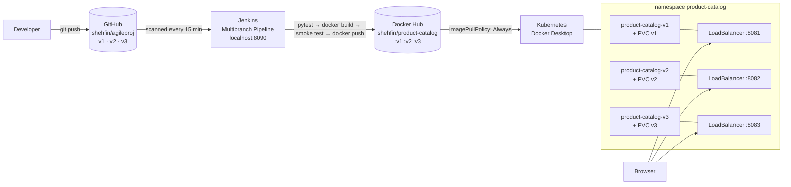

# Product Catalog: an end-to-end DevOps project

**Student ID:** 24MIS0175

This is a small product catalog web application, built in three versions and delivered through a complete DevOps pipeline:

```
Flask + SQLite app  →  pytest  →  Git/GitHub (branch per version)  →  Jenkins CI
                    →  Docker image  →  Docker Hub  →  Kubernetes (all three versions side by side)
```

| | Link |
|---|---|
| Source code | https://github.com/shehfin/agileproj (branches `v1`, `v2`, `v3`) |
| Container images | https://hub.docker.com/r/shehfin/product-catalog (tags `v1`, `v2`, `v3`) |
| Running versions (local Kubernetes) | http://localhost:8081 (v1), http://localhost:8082 (v2), http://localhost:8083 (v3) |
| Jenkins (local) | http://localhost:8090, job `product-catalog` |

This README is identical on all three branches and describes the whole project. The application code differs per branch; `APP_VERSION` in `app/__init__.py` says which version a branch holds.

---

## Contents

1. [Architecture](#1-architecture)
2. [Technology stack](#2-technology-stack)
3. [The three versions](#3-the-three-versions)
4. [Repository layout](#4-repository-layout)
5. [Running the app locally](#5-running-the-app-locally)
6. [Testing](#6-testing)
7. [Version control: branches and history](#7-version-control-branches-and-history)
8. [Docker and Docker Hub](#8-docker-and-docker-hub)
9. [Jenkins CI/CD pipeline](#9-jenkins-cicd-pipeline)
10. [Kubernetes deployment](#10-kubernetes-deployment)
11. [Configuration reference](#11-configuration-reference)
12. [Security measures](#12-security-measures)
13. [Local environment and ports](#13-local-environment-and-ports)
14. [How the project was built, phase by phase](#14-how-the-project-was-built-phase-by-phase)
15. [Problems found and how they were solved](#15-problems-found-and-how-they-were-solved)
16. [Verification summary](#16-verification-summary)
17. [Cleanup](#17-cleanup)
18. [Known limitations and follow-ups](#18-known-limitations-and-follow-ups)

---

## 1. Architecture



- **Code:** one GitHub repository with one branch per version.
- **CI:** Jenkins builds each branch, runs its tests, and publishes only images that pass the tests.
- **CD:** Kubernetes runs all three versions at the same time. Each version has its own database volume and its own `localhost` port.

---

## 2. Technology stack

| Area | Tool | Version used |
|---|---|---|
| Language | Python | 3.13.5 |
| Web framework | Flask (+ Jinja2 templates) | 3.1.0 |
| Production server | gunicorn (2 workers) | 23.0.0 |
| Database | SQLite (one file per version) | bundled with Python |
| Front end | HTML, CSS, plain JavaScript (no frameworks) | n/a |
| Tests | pytest | 8.3.4 |
| Version control | Git + GitHub | Git 2.55 |
| CI/CD | Jenkins (Declarative Pipeline, Multibranch job) | 2.568.3 |
| Containers | Docker Desktop, base image `python:3.13-slim` | Docker 29.9.2 |
| Registry | Docker Hub | n/a |
| Orchestration | Kubernetes (Docker Desktop, kind-based cluster) | v1.36.1 |
| Host OS | Windows 11 | n/a |

---

## 3. The three versions

Each version contains everything from the version before it. This is proven by the tests: the earlier versions' test files are copied unchanged into the later branches and still pass.

### v1: Add, view and search

- **Add Product:** product ID, name, price and quantity.
- **View Products:** a table of all products, sorted by product ID.
- **Search:** partial, case-insensitive match on product ID or name, with a helpful message when nothing matches.
- **Validation (server side):** product ID required and unique (`P001` and `p001` count as the same), name not blank, price numeric and ≥ 0, quantity a whole number ≥ 0.
- **Messages:** clear success and error messages, and the form keeps what you typed after an error.
- **Data:** stored in SQLite using parameterized SQL only; `%` and `_` in searches are matched literally.

### v2: v1 plus edit, delete, stricter validation and a better UI

- **Edit Product:** every field, including the product ID. Duplicate checks skip the product being edited.
- **Delete Product:** POST only, with a confirmation prompt.
- **Stricter validation:**
  - product ID: letters, digits, `-` and `_`, at most 20 characters
  - name: at most 100 characters, extra spaces collapsed
  - price: at most 2 decimal places, 0 to 1,000,000
  - quantity: 0 to 1,000,000, ASCII digits only
- **CSRF protection:** every form carries a token tied to the session.
- **Friendly error pages** for 400, 404, 405 and 500 responses.
- **Case-insensitive search for any language:** for example, `ÉCLAIR` finds `éclair` and `STRASSE` finds `Straße`.
- **Responsive layout:** on phones, table rows become stacked cards.
- **Older data still works:** product IDs saved by v1 that contain `/` can still be opened and deleted.

### v3: v2 plus dashboard, sorting, filtering, low-stock alerts and a health endpoint

- **Dashboard** (`/dashboard`):
  - total products and total quantity
  - inventory value (sum of price × quantity)
  - low-stock and out-of-stock counts, which link to the filtered list
  - a "Running low" list
- **Sorting:** by product ID, name (ignoring case), price or quantity, in either direction. Ties are always listed by product ID.
- **Stock filters:** all, low stock, out of stock, or in stock. These combine with search and sorting.
- **Low-stock indicators:** amber **Low stock** and red **Out of stock** badges, plus highlighted rows.
  - A product is low stock when `quantity < LOW_STOCK_THRESHOLD`. The default is **10**, so 9 is low and 10 is not.
  - The threshold is configurable. An invalid value stops the app at startup with a clear error.
- **Health endpoint:** `GET /health` returns `{"status": "ok", "version": "v3", "database": "ok"}` with HTTP 200, or 503 if the database can't be read. It's used by the Docker `HEALTHCHECK` and the Kubernetes probes.
- **Database failures:** show a friendly 503 page instead of a crash.
- **Clearer empty states:** separate messages for an empty catalog, a search with no matches, and a filter with no results.

### Routes

| Method | URL | v1 | v2 | v3 |
|---|---|:-:|:-:|:-:|
| GET | `/`: list (v3: `?q=&sort=&order=&stock=`) | ✅ | ✅ | ✅ |
| GET | `/search?q=` | ✅ | ✅ | ✅ |
| GET, POST | `/products/add` | ✅ | ✅ | ✅ |
| GET, POST | `/products/<id>/edit` | | ✅ | ✅ |
| POST | `/products/<id>/delete` | | ✅ | ✅ |
| GET | `/dashboard` | | | ✅ |
| GET | `/health` | | | ✅ |

---

## 4. Repository layout

The layout below is the `v3` branch. `v1` and `v2` have a subset of `app/` and `tests/`.

```
.
├── app/
│   ├── __init__.py        create_app() factory, settings, error handlers, APP_VERSION
│   ├── db.py              SQLite connection per request, schema, casefold() SQL function (v2+)
│   ├── routes.py          list / search / sort / filter / add / edit / delete
│   ├── validation.py      server-side form validation
│   ├── security.py        CSRF token check (v2+)
│   ├── dashboard.py       dashboard statistics (v3)
│   ├── health.py          GET /health (v3)
│   ├── templates/         base, index, product_form (add/edit), dashboard, error
│   └── static/            css/style.css, js/app.js (delete confirmation, auto-apply filters)
├── tests/                 pytest suite (see section 6)
├── k8s/                   Kubernetes manifests + README (see section 10)
├── Dockerfile             production image (gunicorn, non-root, HEALTHCHECK in v3)
├── .dockerignore          keeps tests, caches, databases, .venv, .git out of the image
├── Jenkinsfile            Declarative CI/CD pipeline (same on all branches)
├── requirements.txt       runtime dependencies (Flask, gunicorn)
├── requirements-dev.txt   + pytest
├── pytest.ini             test discovery settings
├── run.py                 development server entry point
├── DOCKER.md              image build / run / push / verify guide
├── JENKINS.md             Jenkins setup, pipeline stages, troubleshooting
├── .gitignore             .venv, caches, instance/ (local database), *.db
└── .gitattributes         LF line endings everywhere (Docker and Jenkins safe)
```

---

## 5. Running the app locally

Windows PowerShell:

```powershell
git clone https://github.com/shehfin/agileproj.git
cd agileproj
git checkout v3                      # or v1 / v2

python -m venv .venv
.\.venv\Scripts\Activate.ps1
pip install -r requirements-dev.txt

python run.py                        # http://127.0.0.1:5000
```

The database is created automatically at `instance/products.db`. That folder is ignored by Git.

To try a different low-stock threshold (v3):

```powershell
$env:LOW_STOCK_THRESHOLD = "5"; python run.py
```

---

## 6. Testing

```powershell
python -m pytest -v
```

Every test uses its own temporary SQLite file, so real data is never touched. The tests fix the low-stock threshold at 10, so an environment variable can't change the results.

| Test file | Added in | Tests | Covers |
|---|---|--:|---|
| `test_products.py` | v1 | 31 | add, list, search, 13 kinds of invalid input, duplicate IDs (any letter case), SQL-injection-style search text, persistence after an app restart |
| `test_edit_delete.py` | v2 | 23 | edit (including changing the ID), duplicate on edit, invalid edits, 404s, delete, POST-only delete, reusing a deleted ID, persistence |
| `test_validation.py` | v2 | 34 | every validation rule, tested directly |
| `test_errors_and_search.py` | v2 | 9 | CSRF rejection, friendly 404/405 pages, case-insensitive search for any language, literal `_` |
| `test_dashboard.py` | v3 | 22 | dashboard totals, the low-stock boundary (9 vs 10), "Running low" list, threshold from config and environment, invalid thresholds |
| `test_sort_filter.py` | v3 | 28 | every sort key and direction, ties, unknown values falling back safely, filters, search + filter + sort together, empty states, badges |
| `test_health.py` | v3 | 8 | `/health` 200 and 503 cases, no internal details in responses, friendly database error page |

| Branch | Tests run | Result |
|---|--:|---|
| `v1` | 31 | all pass |
| `v2` | 97 | all pass (includes v1's 31, unchanged) |
| `v3` | 155 | all pass (includes v1's and v2's, unchanged) |

---

## 7. Version control: branches and history

**One repository, three long-lived branches:**

- `v2` was created from `v1`, and `v3` from `v2`, so each version builds on the previous one.
- Shared changes (Docker, CI and Kubernetes files, documentation, fixes) are committed on `v1` and **merged forward** v1 → v2 → v3.
- History is never rewritten: no rebases and no force-pushes.

```
v1  4137e4c ─ 201a965 ─ 4bc9c87 ─ 2fb1cec ─ 80effdf ─ 0a1e874 ─ 5ece50f ─ (README)
      │          │         │         │         │         │         │
v2  330ca10 ─ merge ─── merge ─── merge ─── merge ─── merge ─── merge ─── merge
      │          │         │         │         │         │         │
v3  aae5d4f ─ merge ─── merge ─── merge ─── merge ─── merge ─── merge ─── merge
```

| Commit (on v1 and merged forward, unless marked v2/v3) | What it did |
|---|---|
| `4137e4c` | **v1 app:** add/view/search, validation, 31 tests, Dockerfile |
| `330ca10` (v2) | **v2 app:** edit, delete, stricter validation, CSRF, error pages, responsive UI, 97 tests |
| `aae5d4f` (v3) | **v3 app:** dashboard, sorting, filters, low-stock alerts, `/health`, 155 tests |
| `201a965` | Fix `.dockerignore` so `__pycache__`/`.pyc` files never enter the image |
| `4bc9c87` | Add `DOCKER.md` |
| `2fb1cec` | Add `Jenkinsfile` and `JENKINS.md` |
| `80effdf` | First attempt at the Docker Hub login fix (UTF-8 BOM; didn't work inside Jenkins) |
| `0a1e874` | Working login fix: do `docker login` from `cmd.exe` |
| `5ece50f` | Add Kubernetes manifests (`k8s/`) and update `JENKINS.md` |

Commit messages follow the Conventional Commits style (`feat:`, `fix:`, `ci:`, `docs:`).

---

## 8. Docker and Docker Hub

Full guide: **[DOCKER.md](DOCKER.md)**.

| Property | Value |
|---|---|
| Base image | `python:3.13-slim` |
| Runs as | `appuser` (uid 1000), not root |
| Server | `gunicorn --bind 0.0.0.0:5000 --workers 2 "app:create_app()"` |
| Port | 5000 |
| Database | `/app/data/products.db` (mount a volume on `/app/data`) |
| Image contents | only `app/` and `requirements.txt` (enforced by `.dockerignore`) |
| Labels | `org.opencontainers.image.version` (v1/v2/v3), `org.opencontainers.image.revision` (Git commit), `student.id=24MIS0175` |
| Health check | v3 only: `HEALTHCHECK` calls `/health` |
| Secrets | none baked in; `SECRET_KEY` is passed at run time |
| Size | about 189 MB (45 MB compressed) |

```powershell
# Run any published version
docker run -d -p 5000:5000 -v pc-data:/app/data shehfin/product-catalog:v3

# Which commit was this image built from?
docker inspect -f "{{index .Config.Labels \"org.opencontainers.image.revision\"}}" shehfin/product-catalog:v3
```

**Publishing:**
- The images were first published by hand in Phase 7. Each was built from an exact export of its branch (`git archive`) after that branch's tests passed.
- Since Phase 8, **Jenkins builds and publishes them automatically**.
- Each push was verified by deleting the local image, pulling it back, and comparing digests.

---

## 9. Jenkins CI/CD pipeline

Full guide: **[JENKINS.md](JENKINS.md)**.

A single `Jenkinsfile` (Declarative Pipeline) is shared by all branches. A **Multibranch Pipeline** job called `product-catalog` builds the `v1`, `v2` and `v3` branches. Each branch publishes to the image tag with the same name.

| # | Stage | What happens | On failure |
|---|---|---|---|
| 1 | Checkout | clone the branch, record the commit | stop |
| 2 | Resolve version | only `v1`/`v2`/`v3` allowed; the code's `APP_VERSION` must equal the branch name | stop: nothing is built |
| 3 | Install dependencies | create `.venv`, `pip install -r requirements-dev.txt` | clear message naming the missing tool |
| 4 | Test | `pytest -v`, JUnit report published in Jenkins | **no image is built or pushed** |
| 5 | Build image | `docker build` with the commit label | nothing is pushed |
| 6 | Smoke test image | run the new image, check it answers and shows the right version | nothing is pushed |
| 7 | Push to Docker Hub | log in with the Jenkins credential, push `:<branch>`, log out | message names the credential to check |

**Setup on this machine:**
- Jenkins runs as a Windows service under **LocalSystem**, which can't see your user's PATH or Docker Desktop's normal connection. Three global environment variables solve this:
  - `PATH+PYTHON`: the Python 3.13 folder
  - `PATH+DOCKER`: Docker's `bin` folder
  - `DOCKER_HOST=tcp://localhost:2375`
- Docker Hub access uses the Jenkins credential **`dockerhub-credentials`** (username + access token). It's never written into the Jenkinsfile.
- The login uses a temporary Docker config folder, deleted after the push, so the token is never saved on disk.
- GitHub can't reach a Jenkins running on `localhost`, so the job checks the repository **every 15 minutes** instead of using webhooks.

**What was proven in real Jenkins:**
- All three branches went green end to end. The pushed digests matched Docker Hub.
- A replayed build with one deliberately failing test **stopped at Test**. Build, Smoke test and Push were skipped, and the image on Docker Hub didn't change.

---

## 10. Kubernetes deployment

Full guide: **[k8s/README.md](k8s/README.md)**.

| | v1 | v2 | v3 |
|---|---|---|---|
| Deployment | `product-catalog-v1` | `product-catalog-v2` | `product-catalog-v3` |
| Service | `product-catalog-v1-service` | `product-catalog-v2-service` | `product-catalog-v3-service` |
| URL | http://localhost:8081 | http://localhost:8082 | http://localhost:8083 |
| Image | `shehfin/product-catalog:v1` | `:v2` | `:v3` |
| Storage (own PVC, 256Mi) | `product-catalog-v1-data` | `product-catalog-v2-data` | `product-catalog-v3-data` |
| Probes | `GET /` | `GET /` | `GET /health` |

All of these live in the `product-catalog` namespace. Deploy:

```powershell
kubectl apply -f k8s/namespace.yaml
kubectl -n product-catalog create secret generic product-catalog-secret `
  --from-literal=SECRET_KEY=$(python -c "import secrets; print(secrets.token_hex(32))")
kubectl apply -k k8s/
```

**How `localhost` access works:**
- The cluster is Docker Desktop's **kind-based** cluster. NodePorts were tested and are **not** reachable from Windows.
- `type: LoadBalancer` Services **are** published on Windows `localhost` at their own port, by a small Envoy proxy container that Docker Desktop manages. So Service port 8081 becomes `http://localhost:8081`.
- Unlike `kubectl port-forward`, this keeps working without an open terminal and survives restarts.

**Design choices:**

| Setting | Value | Why |
|---|---|---|
| Replicas and update strategy | 1 replica, `strategy: Recreate` | SQLite on a single-writer volume: two pods must never write the same file |
| `imagePullPolicy` | `Always` | Jenkins re-publishes the same tags, so a restarted pod should get the newest image |
| Resources | requests 50m CPU / 96Mi; limits 500m CPU / 256Mi | Small Flask app with 2 gunicorn workers |
| Security | `runAsNonRoot`, uid/gid 1000, `fsGroup: 1000`, no privilege escalation, all Linux capabilities dropped | Least privilege; the volume stays writable for the app user |
| `SECRET_KEY` | Secret created with `kubectl`, referenced via `secretKeyRef` | Never written into YAML or the repository |

**Releasing a new image:** once Jenkins pushes it, run `kubectl -n product-catalog rollout restart deploy/product-catalog-v2`. This was tested for all three versions: the running digests matched what Jenkins had just pushed, and all data was kept.

---

## 11. Configuration reference

| Environment variable | Used by | Default | Purpose |
|---|---|---|---|
| `SECRET_KEY` | all | `dev-only-change-me` | Signs the session cookie (flash messages, CSRF token). Set a random value outside local use; Kubernetes reads it from a Secret. |
| `DATABASE_PATH` | all | `instance/products.db` locally, `/app/data/products.db` in Docker | Location of the SQLite file |
| `LOW_STOCK_THRESHOLD` | v3 | `10` | `quantity < threshold` counts as low stock. Must be a whole number ≥ 1, otherwise the app refuses to start. |

---

## 12. Security measures

- **SQL injection:** every query is parameterized. Sort columns come from a fixed allow-list, never from user input.
- **Search wildcards:** `%`, `_` and `\` in searches are escaped and matched literally.
- **CSRF (v2+):** every POST form needs a session-bound token, compared in constant time.
- **No internal details exposed:** error pages and `/health` never show stack traces or database error text. Details go to the server log only.
- **Containers:** non-root user, minimal contents, no secrets in image layers. A history scan of all three images found no credentials.
- **Repository:** all commits were scanned. There are no tokens, keys, databases, virtual environments or build artifacts in Git.
- **CI:** the Docker Hub token lives only in Jenkins' credential store and is masked in build logs (0 occurrences found in logs). The login config is temporary and deleted after each push.
- **Kubernetes:** `SECRET_KEY` lives in a Secret, never in YAML. Pods run with all Linux capabilities dropped and no privilege escalation.

---

## 13. Local environment and ports

This project was built on a Windows 11 machine that also runs other software, so ports were chosen with care:

| Port | Used by |
|---|---|
| 5000 | Flask development server (`python run.py`) |
| 8080 | **Oracle 11g XDB** (pre-existing; not part of this project) |
| 8081 | Product Catalog **v1** (Kubernetes LoadBalancer) |
| 8082 | Product Catalog **v2** (Kubernetes LoadBalancer) |
| 8083 | Product Catalog **v3** (Kubernetes LoadBalancer) |
| 8090 | **Jenkins** (moved here from 8081 to free that port for v1) |
| 2375 | Docker Engine API, localhost only (so the Jenkins service can use Docker) |

---

## 14. How the project was built, phase by phase

| Phase | Work done |
|---|---|
| **1. Environment inspection and planning** | Checked Python 3.13.5, pip, Git, Java 21, Docker, kubectl and Jenkins. Planned the folder structure, branching strategy and CI/CD flow. Started Docker Desktop and enabled Kubernetes. Fixed the Git identity (the email had a typo). Set up Docker Hub and GitHub logins. Exposed the Docker API on `localhost:2375` so the Jenkins service could use Docker. |
| **2. Product Catalog v1** | Flask app factory, SQLite storage, add/view/search, server-side validation, parameterized SQL, beginner-friendly UI, Dockerfile, 31 tests. Verified with pytest, the live dev server and a Docker container (including persistence after restart). |
| **3. Git and GitHub** | Created the repository on branch `v1`, added `.gitattributes` for consistent LF line endings, pushed to GitHub, and verified with a fresh clone where all tests passed. |
| **4. Product Catalog v2** | Branched from v1. Added edit, delete, CSRF protection, stricter validation, error pages, search that ignores case in any language, and a responsive UI. 97 tests, with v1's tests unchanged. Verified with the live server and the Docker image. |
| **5. Product Catalog v3** | Branched from v2. Added the dashboard, sorting, stock filters, a configurable low-stock threshold, `/health`, a database-error page and better empty states. 155 tests. Checked the layout with screenshots at desktop and 375 px phone width (and fixed a phone layout bug). Docker `HEALTHCHECK` reports healthy. |
| **6. GitHub history verification** | Cloned each branch fresh and ran its tests (31/97/155). Confirmed each version contains the previous one. Scanned every commit for secrets and stray files. Built each branch's image from a clean clone. |
| **7. Docker and Docker Hub** | Built each tag from an exact export of its branch, tested add/search/persistence in containers, fixed `.dockerignore`, pushed v1/v2/v3, and verified by pulling and comparing digests. Wrote `DOCKER.md`. |
| **8. Jenkins CI/CD** | Wrote the Jenkinsfile and `JENKINS.md`. Configured the Jenkins agent environment and created the Multibranch job through the Jenkins API. Debugged and fixed the Docker Hub login, ran all three branches green, and proved that a failing test blocks publishing. |
| **9. Kubernetes** | Inspected the cluster and tested which access methods reach `localhost`. Wrote manifests (namespace, PVC + Deployment + Service per version), created the Secret, and moved Jenkins to 8090 so v1 could use 8081. Verified images, probes, Add/View/Search on all three URLs, storage isolation, and persistence across pod deletion and rollouts. |
| **Documentation** | This README, `DOCKER.md`, `JENKINS.md` and `k8s/README.md`. |

---

## 15. Problems found and how they were solved

Real problems hit during the project, kept here because they're useful to know:

| Problem | Cause | Solution |
|---|---|---|
| `kubectl` reported a credentials error although no cluster was set up, and later Jenkins API calls returned 401 | Port **8080 belongs to Oracle 11g XDB** (`WWW-Authenticate: Basic realm="XDB"`), not Jenkins. An empty kubeconfig also makes `kubectl` call `localhost:8080`. | Found Jenkins' real port by checking which process owns each listening port. Jenkins was on 8081, later moved to 8090. |
| The Jenkins service couldn't find Python or Docker, or reach Docker Desktop | It runs as LocalSystem, without your user PATH and without access to Docker Desktop's private connection. Your Windows password wasn't available to change the service account. | Exposed Docker on `tcp://localhost:2375` (localhost only) and added `PATH+PYTHON`, `PATH+DOCKER` and `DOCKER_HOST` as Jenkins global variables. |
| `.pyc` files ended up inside the Docker image | In `.dockerignore`, a pattern without `**/` only matches at the top level of the build folder | Changed to recursive patterns (`**/__pycache__`, `**/*.py[cod]`) and confirmed 0 `.pyc` files in the image |
| A Git commit failed and part of the message was read as a file name | PowerShell 5.1 splits a `-m` message that contains double quotes | Write the message to a file and use `git commit -F <file>` |
| The smoke test timed out although the container was up | `localhost` tries IPv6 `::1` first, which the published port doesn't answer; each try waited about 2 seconds | Use `127.0.0.1` and a 5-second timeout |
| A local dry run of `python -m venv` failed in `ensurepip` | The folder path was too deep for Windows' 260-character limit | Used a short path. Jenkins workspaces are short enough, but the limit is documented. |
| Jenkins push: `unauthorized: incorrect username or password` with a valid token | Jenkins' PowerShell step adds a hidden UTF-8 **byte-order mark (BOM)** in front of text piped to programs, so `docker login` received BOM + token. Setting `$OutputEncoding` did **not** help inside Jenkins. | Proved it by testing logins with exact bytes, a newline, and a BOM prefix. Fixed by doing the login in a `bat` step (`echo %TOKEN%\| docker login --password-stdin`). |
| v1's Service stayed `<pending>` on port 8081 | Jenkins already used 8081. Docker Desktop's load-balancer proxy can't bind a busy port. | Moved Jenkins to 8090 (`jenkins.xml`), updated the Jenkins URL setting, and made the Service retry straight away |
| Two of my own tests failed during development | One expected a deleted product's name to disappear from the page, but the "was deleted" message names it. Another expected tied sort values to reverse when sorting descending. | Corrected the test expectations. The app's behaviour was right and is now documented. |
| A phone-width screenshot looked cut off | Headless Edge enforces a minimum window width | Re-checked inside a 375 px iframe; that revealed and fixed one real layout issue (the quantity cell) |

**Security incident (disclosed):** during the BOM investigation, a Jenkins script-console test printed its final return value, and that value contained the Docker Hub token. The token appeared in the working session's output, never in the repository, the images or the Jenkins build logs. Revoking that token and creating a new one is recommended (see section 18). Every later script that reads a credential ends with `return null`.

---

## 16. Verification summary

| Check | Result |
|---|---|
| Unit and integration tests | v1 **31**, v2 **97**, v3 **155**: all passing, locally, in fresh clones and in Jenkins |
| Each version includes the previous one | Earlier test files are byte-identical on later branches and pass |
| Git hygiene | No secrets, databases, virtual environments or build artifacts in any commit |
| Docker images | Non-root, listen on `0.0.0.0:5000`, correct version labels, 0 `.pyc` files, no secrets in layers |
| Docker Hub | Pulled digests equal pushed digests for all three tags |
| Jenkins | All three branches green; tests run before publishing; a failing test blocks the push; the token is masked in logs |
| Kubernetes | 3 Deployments ready, 3 Services with addresses, 3 PVCs bound; no probe failures, restarts or pull errors |
| URLs | 8081 shows v1, 8082 shows v2, 8083 shows v3; Add, View and Search work on all three |
| Storage isolation | Each version's database holds only its own products |
| Persistence | Data survived pod deletion and a rolling update to new images |
| Release flow | `rollout restart` picked up the digests Jenkins had just pushed |

---

## 17. Cleanup

These commands remove things. Run only what you need.

```powershell
# Kubernetes: stop the apps but keep their data
kubectl -n product-catalog delete deploy product-catalog-v1 product-catalog-v2 product-catalog-v3
kubectl -n product-catalog delete svc product-catalog-v1-service product-catalog-v2-service product-catalog-v3-service

# Kubernetes: remove everything, including all three databases (cannot be undone)
kubectl delete namespace product-catalog

# Local Docker images
docker rmi shehfin/product-catalog:v1 shehfin/product-catalog:v2 shehfin/product-catalog:v3

# Local development database
Remove-Item -Recurse instance
```

To stop Jenkins from rebuilding automatically, disable the `product-catalog` job in Jenkins rather than deleting it.

---

## 18. Known limitations and follow-ups

- **SQLite means one pod per version.** Scaling out would need a client/server database such as PostgreSQL.
- **The Docker API on `tcp://localhost:2375` has no authentication.** Any program on this PC can control Docker through it. That's acceptable for a local learning setup only.
- **The apps can be reached from your network.** Docker Desktop's load-balancer proxy listens on all network interfaces, so other devices can reach ports 8081–8083 unless Windows Firewall blocks them.
- **Pods need Docker Hub to start.** With `imagePullPolicy: Always`, a pod pulls its image when it starts. Pinning images by digest would allow offline restarts.
- **Deploying to Kubernetes is a manual step.** Jenkins stops at Docker Hub; you run `kubectl rollout restart` yourself. A deploy stage could be added with a kubeconfig credential.
- **Credentials to revoke when you're done:**
  - the Docker Hub access token used by Jenkins (it was exposed once during debugging)
  - the `claude-setup` Jenkins API token used to configure Jenkins
- **Test data:** the databases running in Kubernetes still contain test products (`K8S-v1`, `K8S-v2-url`, …). Delete them in the UI if you want empty catalogs.
